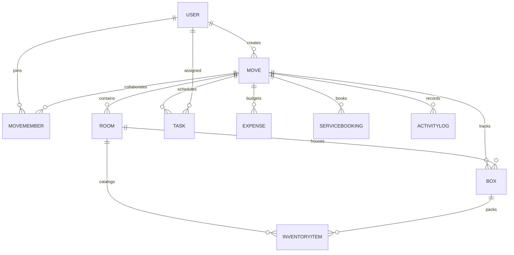

# MoveMate – Intelligent Home Moving Coordinator

[](https://nodejs.org/)
[](https://reactjs.org/)
[](https://vitejs.dev/)
[](https://tailwindcss.com/)
[](https://www.mongodb.com/)
[](https://github.com/)
[](LICENSE)

> A full-stack MERN application that transforms the chaotic experience of moving into an organized, stress-free operation. MoveMate features an automated **4-Pillar Readiness Index**, **printable QR code box labels**, a **live Moving Day Tracker**, **budget variance calculations**, and **role-based team collaboration**.

---

## 📑 Table of Contents

1. [Problem Statement & Solution](#1-problem-statement--solution)
2. [Key Features Walkthrough](#2-key-features-walkthrough)
3. [System Architecture & Data Model](#3-system-architecture--data-model)
4. [Technology Stack](#4-technology-stack)
5. [Project Directory Structure](#5-project-directory-structure)
6. [Local Installation & Setup Guide](#6-local-installation--setup-guide)
7. [Running Automated Tests](#7-running-automated-tests)
8. [Postman API Collection](#8-postman-api-collection)
9. [REST API Reference](#9-rest-api-reference)
10. [Engineering Highlights & Portfolio Talking Points](#10-engineering-highlights--portfolio-talking-points)

---

## 1. Problem Statement & Solution

### The Moving Crisis
Psychological studies frequently rank moving homes among life's top five most stressful events—alongside divorce and career changes. Traditional moves suffer from:
* **Uncertainty & Panic**: No objective answer to *"Are we ready for moving day?"*
* **Lost & Damaged Items**: Unlabeled boxes, mystery contents, and forgotten fragile items.
* **Coordination Breakdown**: Miscommunication between family members, friends, and professional movers.
* **Budget Creep**: Surprise moving expenses exceeding estimates with no financial tracking.
* **Moving Day Chaos**: Lack of a real-time transit pipeline to track loaded, delivered, and missing boxes.

### MoveMate's Intelligent Solution
MoveMate coordinates the entire moving journey from early planning to final box unpacking:
* **Mathematical Moving Readiness**: Computes an objective Readiness Score ($0 - 100\%$) across four critical pillars.
* **Physical-to-Digital Bridge**: Generates scannable QR codes for every box with one-click printable labels.
* **Real-Time Moving Day Pipeline**: Tracks containers through physical transit stages (`Packed` &rarr; `Loaded` &rarr; `In Transit` &rarr; `Delivered`) and alerts immediately on missing items.
* **Collaborative Delegation**: Multi-user permissions (`Owner`, `Editor`, `Viewer`) with live task completion velocity metrics.

---

## 2. Key Features Walkthrough

### 🎯 1. Smart Moving Readiness Engine (Dashboard)
Rather than guessing moving progress, MoveMate calculates a deterministic readiness score between $0\%$ and $100\%$ using a weighted formula:

$$\text{Readiness Score} = (\text{Essential Tasks} \times 35\%) + (\text{Box Packing} \times 30\%) + (\text{Room Inventory} \times 20\%) + (\text{Utility Bookings} \times 15\%)$$

* **Pillar 1: Essential Tasks ($35\%$)**: Tracks completion of high-priority checklist items (truck rentals, lease notices).
* **Pillar 2: Box Packing Progress ($30\%$)**: Percentage of containers packed or delivered.
* **Pillar 3: Room Inventory ($20\%$)**: Individual household items packed into designated boxes.
* **Pillar 4: Utility & Service Bookings ($15\%$)**: Critical transfer confirmations (electricity, water, internet, movers).
* **Categorical State**: Automatically classifies moving plans into `Not Ready`, `In Progress`, `Almost Ready`, and `Moving Ready`.

### 📦 2. Scannable QR Codes & Printable Box Labels
* Generates structured box identifiers, e.g., `BOX-KIT-001` (Kitchen) or `BOX-LIV-002` (Living Room).
* Embeds secure, non-sensitive JSON metadata inside a Base64 PNG QR code.
* Provides a browser-native **Print Label Modal** formatted with cut lines, fragile warnings, priority indicators, room color bands, and scannable QR codes.

### 🚚 3. Real-Time Moving Day Tracker
* Visualizes container logistics across physical stages:
  * **At Origin**: Boxes packed and awaiting truck loading.
  * **In Transit**: Boxes currently on the road.
  * **Delivered**: Containers safely arrived at the destination.
  * **Missing Alert**: Red banner instantly flagging unaccounted containers.
* Live delivery percentage counter with room-by-room breakdown.

### 👥 4. Team Collaboration & Role-Based Permissions
* Invite family, roommates, or helpers by email.
* Three distinct roles:
  * **Owner**: Full administrative control, deletion, invitations, and financial edits.
  * **Editor**: Full packing workflow (create/edit rooms, boxes, tasks, items).
  * **Viewer**: Read-only access to tracking pipeline, inventory, and checklist.
* **Member Task Velocity**: Shows real-time task completion statistics per collaborator (`total`, `completed`, `pending`, `overdue`, and `% completion rate`).

### 💰 5. Budget Variance & Expense Tracker
* Tracks estimated costs vs. actual spending across categories (`Movers`, `Packing Supplies`, `Truck Rental`, `Storage`, `Utilities`, etc.).
* Dynamically calculates net variance ($+/- \$$) and flags budget overruns.
* Paid vs. unpaid expense breakdown.

### 📋 6. Task Management & Overdue Alerts
* Tasks categorized by priority: `Low`, `Medium`, `High`, `Urgent`.
* Overdue detection: Tasks past their `dueDate` that remain incomplete automatically show red overdue badges and dashboard warnings.

### 📜 7. Activity Audit Timeline
* Comprehensive historical timeline recording every creation, update, status change, and member invitation with actor attribution and relative timestamps.

---

## 3. System Architecture & Data Model

### Architectural Overview

```
┌─────────────────────────────────────────────────────────────┐
│                       Client Layer                          │
│   React 18 SPA + Vite + Tailwind CSS + Lucide React + Axios │
└──────────────────────────────┬──────────────────────────────┘
                               │ HTTPS / REST (JSON)
                               ▼
┌─────────────────────────────────────────────────────────────┐
│                      Server Layer                           │
│   Express.js (Node.js) + Helmet + CORS + Rate Limiter       │
│                                                             │
│   ├── Auth Middleware (JWT Bearer Verification)             │
│   ├── Multi-Tenant Authorization (checkMoveAccess)          │
│   ├── Zod Input Validation Layer                            │
│   └── Business Logic Controllers & Services                 │
└──────────────────────────────┬──────────────────────────────┘
                               │ Mongoose ODM
                               ▼
┌─────────────────────────────────────────────────────────────┐
│                     Database Layer                          │
│               MongoDB Atlas Cloud Cluster                   │
│   10 Collections with Compound Unique Indexes & Cascades    │
└─────────────────────────────────────────────────────────────┘
```

### Entity-Relationship Diagram



### Database Collections Summary

| Collection | Description | Key Indexes & Relations |
|---|---|---|
| `users` | User credentials, profile, hashed passwords (`bcryptjs`). | Unique index on `email`. |
| `moves` | Core moving plan (addresses, date, status, owner). | Indexed on `userId`, `moveDate`, `status`. |
| `movemembers` | Collaborators and roles (`Owner`, `Editor`, `Viewer`). | Compound unique index on `{ moveId: 1, userId: 1 }`. |
| `rooms` | Destination rooms with color codes and floor levels. | Compound unique index on `{ moveId: 1, name: 1 }`. |
| `boxes` | Containers with labels (`BOX-KIT-001`) and Base64 QR codes. | Compound unique index on `{ moveId: 1, boxLabel: 1 }`. |
| `inventoryitems`| Individual household possessions with value and fragile flag. | Indexed on `roomId`, `boxId`. |
| `tasks` | Checklist items with due dates, priority, and assignees. | Indexed on `moveId`, `assignedTo`, `dueDate`. |
| `expenses` | Moving costs with estimated vs. actual amounts. | Indexed on `moveId`, `category`. |
| `servicebookings`| Utility transfers and professional mover bookings. | Indexed on `moveId`, `scheduledDate`. |
| `activitylogs` | Paginated audit trail recording operations. | Indexed on `moveId`, `-createdAt`. |

---

## 4. Technology Stack

### Frontend
* **Core Framework**: React 18 (`react`, `react-dom`)
* **Build Tool**: Vite 6 (Ultra-fast HMR and Rollup production bundling)
* **Styling**: Tailwind CSS 3 (Custom design system with `brand` indigo palette)
* **Routing**: React Router v6 (`react-router-dom`)
* **HTTP Client**: Axios with Bearer token interceptor
* **Icons**: Lucide React

### Backend
* **Runtime**: Node.js v18+
* **Framework**: Express.js 4
* **Database & ODM**: MongoDB Atlas & Mongoose 8
* **Authentication**: JSON Web Tokens (`jsonwebtoken`) + Password Hashing (`bcryptjs`)
* **Validation**: Zod (Strict schema validation for all incoming requests)
* **Security**: Helmet (HTTP security headers), CORS (origin whitelisting), Express Rate Limit
* **QR Generation**: QRCode (Base64 data URLs)

---

## 5. Project Directory Structure

```
MoveMate/
├── backend/
│   ├── src/
│   │   ├── config/             # Database connection & Atlas DNS SRV
│   │   ├── constants/          # Enums (statuses, roles, categories)
│   │   ├── controllers/        # Express route handlers
│   │   ├── middleware/         # Auth, move access guards, Zod validator, error handler
│   │   ├── models/             # 10 Mongoose schemas & indexes
│   │   ├── routes/             # REST route declarations
│   │   ├── services/           # Core business logic (readiness, tracking, QR helper)
│   │   ├── utils/              # ApiResponse, ApiError, asyncHandler, QR helper
│   │   ├── validators/         # Zod schemas for all endpoints
│   │   ├── app.js              # Express app configuration & middleware
│   │   └── server.js           # Server entry point
│   ├── tests/                  # 8 Automated integration test suites (104 tests)
│   ├── .env.example            # Backend environment template
│   └── package.json
│
├── frontend/
│   ├── src/
│   │   ├── api/                # Axios instance & 9 API service modules
│   │   ├── components/
│   │   │   ├── common/         # Badge, Modal, StatCard, EmptyState, LoadingSpinner
│   │   │   └── layout/         # Navbar, Sidebar, AppLayout
│   │   ├── context/            # AuthContext, MoveContext
│   │   ├── pages/              # 14 Full application pages
│   │   ├── App.jsx             # React Router route definitions & guards
│   │   ├── main.jsx            # React root mount & providers
│   │   └── index.css           # Tailwind directives & styles
│   ├── index.html              # HTML5 entry with Plus Jakarta Sans font
│   ├── vite.config.js          # Vite config with backend reverse proxy
│   ├── tailwind.config.js      # Custom theme & brand color palette
│   └── package.json
│
├── postman/
│   ├── MoveMate_API.postman_collection.json     # Turnkey Postman collection
│   ├── MoveMate_Local.postman_environment.json  # Pre-configured environment
│   └── README.md                                # Postman execution guide
│
├── ARCHITECTURE.md             # In-depth architectural blueprint
├── API_DOCUMENTATION.md        # Comprehensive REST API specifications
├── DEVELOPMENT_STATUS.md       # Phase-by-phase completion tracker
└── README.md                   # Main project documentation
```

---

## 6. Local Installation & Setup Guide

Follow these steps to run MoveMate locally on your machine.

### Prerequisites
* **Node.js** v18.0.0 or higher ([Download Node.js](https://nodejs.org/))
* **Git** installed ([Download Git](https://git-scm.com/))
* **MongoDB**: A free MongoDB Atlas connection string (or a local MongoDB running at `mongodb://localhost:27017/movemate`)

---

### Step 1: Clone the Repository
```bash
git clone https://github.com/your-username/MoveMate.git
cd MoveMate
```

---

### Step 2: Configure the Backend Environment
1. Navigate into the `backend/` folder:
   ```bash
   cd backend
   ```
2. Create a `.env` file based on `.env.example`:
   ```bash
   cp .env.example .env
   ```
3. Open `.env` and fill in your values:
   ```env
   PORT=5000
   NODE_ENV=development
   MONGODB_URI=mongodb+srv://<username>:<password>@cluster0.example.mongodb.net/movemate?retryWrites=true&w=majority
   JWT_SECRET=your_super_secret_jwt_key_at_least_32_characters_long
   JWT_EXPIRES_IN=7d
   CLIENT_URL=http://localhost:3000
   RATE_LIMIT_WINDOW_MS=900000
   RATE_LIMIT_MAX=500
   ```
4. Install backend dependencies:
   ```bash
   npm install
   ```
5. Start the backend server:
   ```bash
   npm run dev
   ```
   *You will see:* `✅ MongoDB Connected successfully` and `🚀 MoveMate Backend Server running on port 5000`.

---

### Step 3: Configure and Start the Frontend
1. Open a **new terminal window** and navigate into the `frontend/` folder:
   ```bash
   cd frontend
   ```
2. Install frontend dependencies:
   ```bash
   npm install
   ```
3. Start the Vite development server:
   ```bash
   npm run dev
   ```
   *You will see:* `➜ Local: http://localhost:3000/`.

---

### Step 4: Open the Application
* Open your browser and navigate to **`http://localhost:3000`**.
* Click **Register** to create an account, create your first moving plan, add rooms, generate box QR codes, and monitor readiness!

---

## 7. Running Automated Tests

MoveMate features **104 automated integration tests** that test all endpoints against live MongoDB collections.

### Run All Backend Integration Tests
```bash
cd backend
npm test
```

### Run Individual Test Suites
```bash
npm run test:health       # System health & security headers (4 tests)
npm run test:models       # Mongoose models, compound unique indexes (5 tests)
npm run test:auth         # User registration, JWT login, profile (8 tests)
npm run test:moves        # Move & Task CRUD, overdue detection (12 tests)
npm run test:rooms        # Rooms, Boxes, QR codes & Inventory (20 tests)
npm run test:members      # Collaboration, roles, task velocity (20 tests)
npm run test:dashboard    # Readiness engine, tracker, expenses (20 tests)
npm run test:e2e          # Complete lifecycle end-to-end verification (15 tests)
```

### Build Frontend for Production
```bash
cd frontend
npm run build
```
*Outputs an optimized, minified bundle into `frontend/dist/` with zero compilation errors.*

---

## 8. Postman API Collection

A turnkey Postman collection and environment are provided in the `/postman` directory:

1. Open **Postman**.
2. Click **Import** and select:
   * `postman/MoveMate_API.postman_collection.json`
   * `postman/MoveMate_Local.postman_environment.json`
3. Select **MoveMate Local Environment** in the environment dropdown.
4. Execute requests sequentially or click **Run collection**.
   * Postman test scripts automatically capture the JWT `token`, `moveId`, `roomId`, `boxId`, and `taskId` into environment variables for sequential calls.

---

## 9. REST API Reference

All API routes are prefixed with `/api/v1` and return standardized JSON responses:
```json
{
  "success": true,
  "message": "Human-readable description",
  "data": { ... }
}
```

### Quick Route Reference

| Method | Endpoint | Description | Access |
|---|---|---|---|
| `GET` | `/health` | Server uptime & service health | Public |
| `POST` | `/auth/register` | Register user account | Public |
| `POST` | `/auth/login` | Authenticate user & issue JWT | Public |
| `GET` | `/auth/me` | Fetch active user profile | Authenticated |
| `GET` | `/moves` | List moving plans for current user | Authenticated |
| `POST` | `/moves` | Create new moving plan | Authenticated |
| `GET` | `/moves/:moveId` | Get moving plan details | Member (Viewer+) |
| `PATCH` | `/moves/:moveId` | Update moving plan | Member (Owner) |
| `DELETE` | `/moves/:moveId` | Delete plan & cascade child records | Member (Owner) |
| `GET` | `/moves/:moveId/dashboard` | **Smart 4-Pillar Readiness Score** | Member (Viewer+) |
| `GET` | `/moves/:moveId/tracking` | **Moving Day Tracker Transit Status** | Member (Viewer+) |
| `GET` | `/moves/:moveId/activity` | Paginated activity audit feed | Member (Viewer+) |
| `GET` | `/moves/:moveId/rooms` | List rooms with packing progress | Member (Viewer+) |
| `POST` | `/moves/:moveId/rooms` | Create destination room | Member (Editor+) |
| `GET` | `/moves/:moveId/boxes` | List boxes with filters | Member (Viewer+) |
| `POST` | `/moves/:moveId/boxes` | **Create box + generate Base64 QR code** | Member (Editor+) |
| `GET` | `/boxes/:boxId` | Get box & QR code with packed items | Member (Viewer+) |
| `PATCH` | `/boxes/:boxId` | Update box status (state machine) | Member (Editor+) |
| `GET` | `/rooms/:roomId/items` | List items with search | Member (Viewer+) |
| `POST` | `/rooms/:roomId/items` | Add item & assign to box | Member (Editor+) |
| `GET` | `/moves/:moveId/tasks` | List tasks with priority/overdue filters | Member (Viewer+) |
| `POST` | `/moves/:moveId/tasks` | Create task & assign to member | Member (Editor+) |
| `GET` | `/moves/:moveId/members` | **List members & task velocity stats** | Member (Viewer+) |
| `POST` | `/moves/:moveId/members` | Invite collaborator by email | Member (Owner) |
| `PATCH` | `/moves/:moveId/members/:id`| Update collaborator role | Member (Owner) |
| `DELETE` | `/moves/:moveId/members/:id`| Remove collaborator & unassign tasks | Member (Owner) |
| `GET` | `/moves/:moveId/expenses` | List expenses & **budget variance** | Member (Viewer+) |
| `POST` | `/moves/:moveId/expenses` | Add moving expense | Member (Editor+) |
| `GET` | `/moves/:moveId/bookings` | List utility transfers & mover bookings | Member (Viewer+) |
| `POST` | `/moves/:moveId/bookings` | Create service booking | Member (Editor+) |

*For complete request/response schemas and status codes, see [API_DOCUMENTATION.md](file:///c:/Users/shaik%20asif/OneDrive/Desktop/MoveMate/API_DOCUMENTATION.md).*

---

## 10. Engineering Highlights & Portfolio Talking Points

If discussing this project in a college presentation, viva, or interview, highlight these architectural decisions:

1. **Multi-Tenant Data Isolation**:
   MoveMate enforces strict hierarchical authorization via custom middleware (`checkMoveAccess` and `checkChildResourceAccess`). Users cannot inspect, modify, or delete moves, boxes, or tasks they do not own or collaborate on.
2. **Deterministic Mathematical Readiness Engine**:
   Rather than arbitrary progress numbers, the Readiness Score is computed in real-time across four weighted pillars ($35\% + 30\% + 20\% + 15\%$), with graceful zero-division fallbacks when moving plans are fresh.
3. **Compound Unique Database Constraints**:
   Avoids race conditions and data anomalies using MongoDB compound indexes:
   * `{ moveId: 1, boxLabel: 1 }` prevents duplicate box numbers.
   * `{ moveId: 1, name: 1 }` prevents duplicate room names.
   * `{ moveId: 1, userId: 1 }` prevents duplicate collaborator memberships.
4. **State Machine Transition Guarding**:
   Containers cannot jump arbitrarily from `Not Started` to `Delivered`. The `boxService` validates state transitions through an explicit lifecycle graph (`Packing` &rarr; `Packed` &rarr; `Loaded` &rarr; `In Transit` &rarr; `Delivered`), preventing logical errors during moving day.
5. **Cascading Integrity Cleanup**:
   Deleting a moving plan automatically cascades deletion across all linked rooms, boxes, inventory items, tasks, expenses, service bookings, member associations, and activity logs.
6. **Robust Input Validation with Zod**:
   Every request body, route parameter, and query string is parsed against a strict Zod schema before reaching business controllers, rejecting malformed inputs with descriptive 400 error messages.

---

## 📄 License
This project is open-source and available under the **ISC License**.
